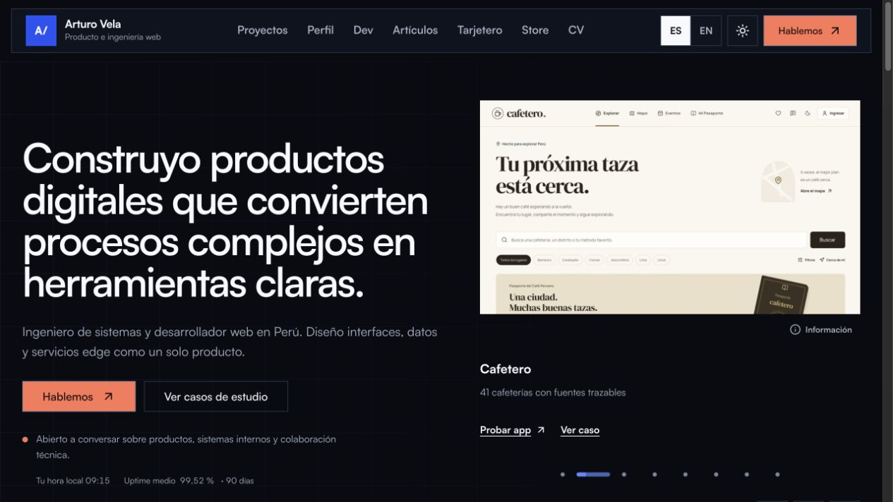
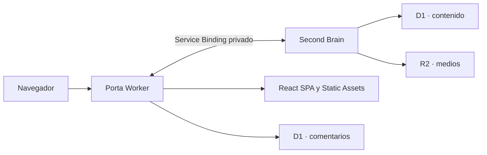

# Porta · Arturo Vela

**Portafolio de ingeniería de producto con React, TypeScript y Cloudflare Workers.**

Reúne productos, casos de estudio, experiencia y artículos en español e inglés. Una SPA de React y Chakra UI comparte Worker con su API; Second Brain publica el contenido y los medios mediante un enlace privado entre servicios.

[Ver sitio](https://velaarturo.com/) · [Proyectos](https://velaarturo.com/es/proyectos) · [Desarrollo local](#desarrollo-local) · [Operación y despliegue](docs/OPERATIONS.md)

<a href="https://velaarturo.com/">
  
</a>

<sub>Captura del sitio público tomada el 17 de noviembre de 2026. El contenido editorial se actualiza desde Second Brain.</sub>

## Qué incluye

| Superficie | Función |
| --- | --- |
| Portada y proyectos | Productos destacados, catálogo y casos con capturas y galerías. |
| Perfil y contacto | Experiencia, servicios y formulario con consentimiento. |
| Dev y tarjetero | Actividad de desarrollo, aplicaciones y accesos al ecosistema. |
| Publicaciones | Artículos y comentarios protegidos con Turnstile. |
| Idiomas y apariencia | Español e inglés, temas claro y oscuro y movimiento reducido. |
| Publicación en el edge | HTML inicial con contenido y metadatos, sitemap, feed y redirecciones. |

## Arquitectura



- React 19, TypeScript estricto, Vite y React Router en modo librería.
- Chakra UI 3 con tokens semánticos, tema claro/oscuro y Satoshi.
- Workers Static Assets para bundles, fuentes y recursos propios.
- Service Binding privado `BRAIN` para contenido publicado y medios de Second Brain.
- D1 independiente para comentarios; Turnstile se valida en el Worker.
- Formspree continúa atendiendo el formulario de contacto.

El contenido público usa el contrato versionado en [`contracts/portfolio-v1.example.json`](contracts/portfolio-v1.example.json). Con el binding y el secreto configurados, Second Brain es la fuente de verdad: Porta sirve su manifiesto v1 o una copia válida obtenida previamente. El snapshot de `src/content/fallback.ts` queda reservado para desarrollo local o entornos sin la integración completa; un fallo de la integración configurada sin respaldo válido se expone como error y no se oculta con contenido bundled.

## Desarrollo local

Requisitos: **Node.js 22 o posterior** y **pnpm 11**. `package.json` fija `pnpm@11.20.0`.

```bash
git clone https://github.com/ArturoVela/Porta.git
cd Porta
pnpm install --frozen-lockfile
cp .dev.vars.example .dev.vars
cp .env.example .env.local
```

Edita las variables copiadas desde los ejemplos antes de iniciar. Para explorar el contenido empaquetado, deja `BRAIN_CONTENT_TOKEN` vacío; para consumir Second Brain, sustituye el marcador por el secreto real del entorno. El binding de desarrollo se configura como remoto en `wrangler.jsonc`: Cloudflare puede requerir autenticación para conectarlo.

Variables privadas del Worker en `.dev.vars`:

- `BRAIN_CONTENT_TOKEN`: secreto largo y aleatorio compartido únicamente con Second Brain.
- `TURNSTILE_SECRET_KEY`: clave privada de Turnstile.

Variable pública de Vite en `.env.local`:

- `VITE_TURNSTILE_SITE_KEY`: clave pública del widget de Turnstile.

No se deben confirmar archivos `.dev.vars` ni `.env.local`. Los comentarios requieren D1 y las claves de Turnstile; el formulario de contacto utiliza Formspree.

```sh
pnpm types
pnpm db:migrate:local
pnpm dev
```

Abre la URL que muestre Vite.

## Verificación

```bash
pnpm check
pnpm build:staging
pnpm build:production
pnpm types:check
pnpm deploy:dry
```

Las pruebas cubren el contrato público, redirecciones, payloads de comentarios, mismo origen, metadatos y 404 de publicaciones. `deploy:dry` comprueba el paquete del Worker sin publicarlo.

## Estructura del repositorio

| Ruta | Responsabilidad |
| --- | --- |
| [`src/pages/`](src/pages/) | Portada, proyectos, perfil, publicaciones, Dev y contacto. |
| [`src/components/`](src/components/) | Interfaz, medios y controles compartidos. |
| [`src/content/`](src/content/) | Proveedor de contenido y snapshots de respaldo. |
| [`src/lib/`](src/lib/) | Contratos, rutas, idiomas y reglas de presentación. |
| [`worker/`](worker/) | API, metadatos, redirecciones e integraciones del servidor. |
| [`migrations/`](migrations/) | Esquema D1 de comentarios y consentimiento. |
| [`tests/`](tests/) | Contratos y comportamiento de interfaz y Worker. |
| [`docs/OPERATIONS.md`](docs/OPERATIONS.md) | Integración, migraciones, privacidad y despliegue por entorno. |

## Operación y documentación

La [guía de operación](docs/OPERATIONS.md) conserva los procedimientos para Second Brain, D1, privacidad, importación histórica y despliegue. Los scripts `deploy:staging` y `deploy:production` aplican migraciones remotas y publican el Worker.

La interfaz utiliza los tokens de [`src/theme.ts`](src/theme.ts) y los estilos de [`src/styles.css`](src/styles.css). Conserva esos patrones al añadir componentes. Las aplicaciones enlazadas tienen sus propias condiciones y configuración.

## Autoría y licencia

Desarrollado por [Arturo Vela](https://velaarturo.com/). Contacto: [dev@velaarturo.com](mailto:dev@velaarturo.com).

Este repositorio no declara una licencia general de reutilización. Las dependencias y los recursos de terceros conservan sus respectivas licencias.
